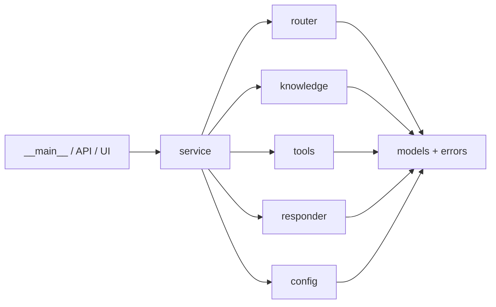
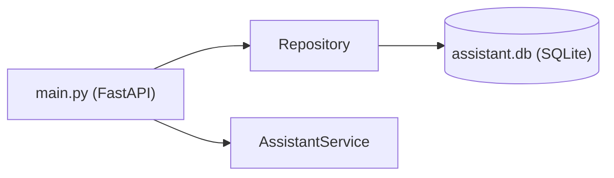
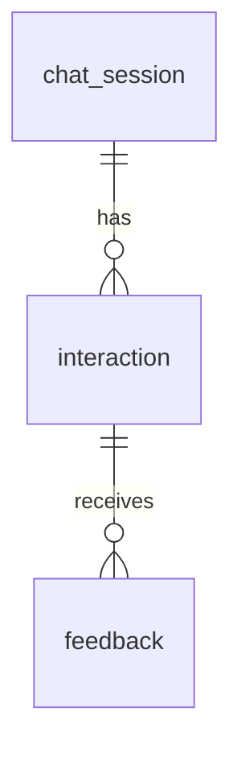
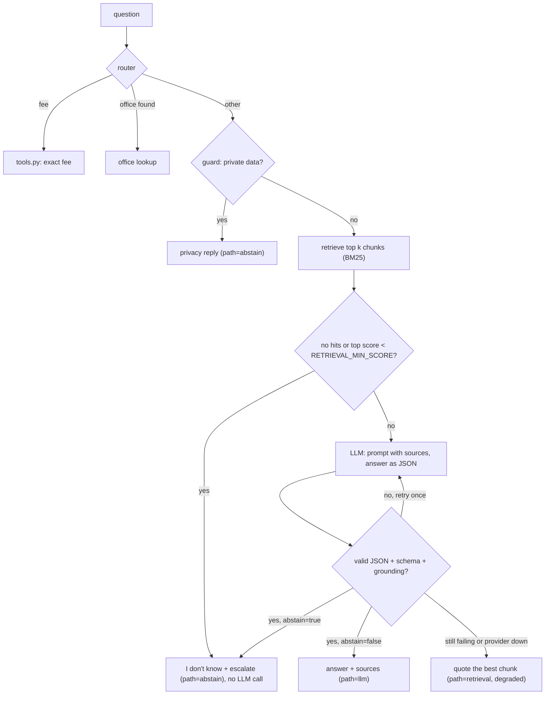
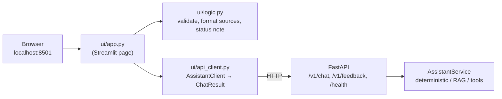

# assistant_core — Architecture

`assistant_core` is a small Python package refactored from `monolith/assistant_monolith.py`.
Behaviour is unchanged; structure is not. Every client (CLI today, FastAPI in Lab 4, UI in Lab 7)
calls one method: `AssistantService.handle(Message) -> Response`.

## 1. Modules and owners

| Module | Responsibility | Owner |
|---|---|---|
| `config.py` | Read settings from the environment / `.env`; validate | Thông |
| `errors.py` | Named exceptions (`AssistantError` and subclasses) | Hải |
| `models.py` | Public contract: `Message`, `Response`, `Intent`, `Source` (plus `Office`, `Rule`) | Hải |
| `router.py` | Choose an `Intent` with simple rules | Đức Huy |
| `knowledge.py` | Office directory (CSV) and handbook (JSON) with search | Gia Huy |
| `tools.py` | Deterministic tuition calculation | Đức Huy |
| `responder.py` | Response generation behind one `Responder` interface (template, stub LLM) | THA |
| `service.py` | `AssistantService.handle(Message) -> Response`, the only entry point | Hải |
| `logging_setup.py` | Structured JSON logs (stderr) | Thông |
| `__main__.py` | Command-line interface | Hải |

Dependency rule: leaf modules (`config`, `knowledge`, `tools`, `router`, `responder`) import only
`errors` and `models`, never each other. Only `service.py` wires them together, which avoids circular
imports and lets each member work in parallel.



## 2. Service interface

```python
AssistantService.handle(msg: Message) -> Response
```

- **Message**: `text` (1–2000 chars), `session_id` (default `"local"`).
- **Response**: `answer`, `intent`, `sources[]` (`Source(id, title)`), `degraded`
  (`True` if a fallback answered).
- **Errors**
  - Invalid input -> `ValidationError` (Pydantic, at the `Message` boundary) / `InvalidRequest`
    (e.g. credits out of range).
  - Startup -> `ConfigError` (bad or missing settings) / `DataError` (knowledge file missing or malformed).
  - Provider failures **never reach the caller**: the service catches `ProviderError`, answers with
    `TemplateResponder` and sets `degraded=True`.
- **Dependency injection**: `AssistantService(settings, offices, handbook, responder)`, so tests can
  inject a failing `StubLLMResponder(fail=True)`.
- **Logging**: intent, latency, session and degraded flag only; never the API key or the full user message.

### Responder interface

```python
class Responder(Protocol):
    def explain(self, question: str, rule: Rule) -> str: ...
```

| Implementation | Behaviour |
|---|---|
| `TemplateResponder` | `"<title>: <text>"`, no AI. Also the service's fallback. |
| `StubLLMResponder(fail=False)` | `"Based on '<title>': <text>"`; with `fail=True` raises `ProviderError`. Deterministic, no key, no sleep. |

A real provider class is added in Week 4 without changing `service.py`.

## 3. Design decisions

1. **Fees are computed in `tools.py`, never by an LLM.** Tuition is exact arithmetic: pure functions
   give the same output for the same input, are trivially unit-tested, and cannot hallucinate. A
   characterisation test (`18` credits + `2` retake = `9_450_000`) locks in the monolith's result.
2. **The LLM sits behind `Responder`; the stub needs no key.** Adapter pattern: the service depends
   on a Protocol, not a vendor. Tests and CI run offline and deterministically, failures are simulated
   with `fail=True`, and providers can be swapped without editing the service.
3. **Configuration comes from the environment; `.env.example` documents every variable.**
   (Twelve-Factor III.) Rates, limits and keys are not in code, so changing a fee means editing one
   variable. `llm_api_key` uses `repr=False` and `.env` is git-ignored, so secrets never reach Git or logs.

## 4. Storage layer (Lab 5)

Feedback and interaction metadata are persisted in SQLite through SQLModel. The API never writes SQL:
every database operation goes through one class.

| Piece | Where | Role |
|---|---|---|
| Models | `src/assistant_api/db.py` | `ChatSession`, `Interaction`, `Feedback`: one class = one table |
| `Repository` | `src/assistant_api/db.py` | `record_interaction`, `add_feedback`, `list_feedback`, `intent_stats`. Each call opens a `Session`, adds or queries, then commits (one transaction) |
| Schema SQL | `sql/migrations/001_init.sql` | Equivalent hand-written SQL; `scripts/migrate.py` applies numbered files once |
| Seed data | `scripts/seed.py` | Invented interactions for practising queries |
| Wiring | `src/assistant_api/main.py` | Creates the engine and `Repository(engine, settings.session_salt)` |



### Tables



- `chat_session(id PK, channel, created_at)`: `id` is the hashed session id.
- `interaction(id PK, request_id UNIQUE, session_id FK, intent, topic, resolved, degraded, latency_ms, created_at)`.
- `feedback(id PK, request_id FK, rating, comment, created_at)`: `rating` is -1, 0 or 1; `comment` is optional (max 500 chars).

Full reasoning and the ER diagram are in `lab05/worksheets/data_model.md`.

### Privacy by design

- The raw user message is **never stored**; only metadata (intent, topic, resolved, degraded, latency).
- The session id is stored as `sha256(SESSION_SALT + raw_id)[:16]`: the same session always maps to the same
  code, but the id cannot be recovered. `SESSION_SALT` comes from `.env` (default `dev-salt` for local use only).
- No name, phone number or other personal field exists in the schema.

### Endpoints that use the database

| Endpoint | Behaviour |
|---|---|
| `POST /v1/chat` | Answers, then records one `interaction` (metadata only) and returns its `request_id` |
| `POST /v1/feedback` | Saves a `feedback` row (201). Unknown `request_id` -> 404 |
| `GET /v1/feedback` | Admin (`X-API-Key`): newest first, up to 100 |
| `GET /v1/stats/intents` | Admin: per intent `requests`, `avg_latency_ms`, `unresolved`, most requests first |

Feedback now survives a server restart (it used to be an in-memory list).

## 5. AI services and RAG (Lab 6)

Questions that are not greetings, fees or a known office go to the RAG path instead of the Lab 5 handbook search.
The rule is: search our own documents first, let the model phrase an answer only from what was found, and check
everything the model returns. Money is still computed by `tools.py`: the router sends fee questions to the calculator
before search, so a model never computes a fee.

| Piece | Where | Role |
|---|---|---|
| Guardrail | `guard.py` | Regex rules that stop questions about other students' data (grades, phone, address, student ids) before search or AI |
| Knowledge base | `data/kb/*.md` | Three sample documents with metadata (`doc_id`, `title`, `version`, `owner`) |
| Chunker | `rag/chunker.py` | Splits each document into one chunk per section, with ids such as `H26#5.3` |
| Index | `rag/index.py` | `make_index(kind, chunks)` with kind `bm25`, `tfidf` or `hybrid`; `search(question, k)` returns hits sorted by score |
| Answerer | `rag/answerer.py` | `RagAnswerer.answer(question) -> Response`: abstain, LLM, retry and fallback |
| LLM adapter | `llm.py` | `LLM` protocol with one method `complete(prompt) -> str`; `StubLLM`, `OllamaLLM`, `OpenAICompatibleLLM`; `parse_draft` validates the output |
| Prompt | `prompts/answer_v1.txt` | Instructions + `{sources}` + `{question}`; kept in a file so wording can change without code changes |
| Wiring | `service.py` (`_build_rag`) | Builds the index from `KB_DIR` and the model from `LLM_PROVIDER`; no `data/kb` folder means the Lab 5 handbook path is kept |



### The safety steps, in order

1. **Guard**: `is_private_request` blocks questions about another student before any search.
2. **Retrieve**: BM25 scores each chunk; rarer matching words count more.
3. **Abstain (A1)**: if there are no hits or `hits[0].score < RETRIEVAL_MIN_SCORE` (default 2.0), return
   `ESCALATE_MSG` with `escalate=True`. The model is not called, so it cannot guess from memory.
4. **Structured output**: the model must return `{"answer", "source_ids", "confidence", "abstain"}`, validated by the
   Pydantic class `AnswerDraft` (`confidence` between 0 and 1). Plain text or broken JSON raises `ProviderError`.
5. **Grounding (A2)**: unless the model abstains, it must cite at least one source and every cited id must be in the
   retrieved set (`set(draft.source_ids) <= allowed_ids`). Otherwise the answer is rejected.
6. **Fallback**: after one retry, or if the provider is offline, the answer quotes the best chunk with its source and
   `degraded=True`. It is less friendly but always true.

### Response fields added in Lab 6

`Response` and `/v1/chat` return `path` (`deterministic`, `retrieval`, `llm`, `tool`, `abstain`), `escalate`
(send the student to a human) and `confidence` (from the model; `0.0` when the assistant abstains before calling it).

### Configuration

| Variable | Default | Meaning |
|---|---|---|
| `LLM_PROVIDER` | `stub` | `stub` (offline, deterministic), `template` (no model, retrieval only), `ollama` (local), `openai` (needs `LLM_API_KEY`) |
| `LLM_MODEL`, `LLM_BASE_URL` | provider defaults | Model name and server URL for real providers |
| `LLM_TIMEOUT_S` | `5` | Seconds before a model call counts as failed (then the fallback is used) |
| `KB_DIR` | `data/kb` | Folder of Markdown documents to index |
| `RETRIEVAL_KIND` | `bm25` | `bm25`, `tfidf` or `hybrid` |
| `RETRIEVAL_MIN_SCORE` | `2.0` | Below this top score the assistant abstains |

`eval/compare_paths.py` runs `eval/cases.jsonl` against the deterministic, retrieval and LLM paths and prints how many
cases each answers correctly, how many it correctly refuses, and its latency.

## 6. User interface (Lab 7)

The Streamlit page in `ui/` is just another client of the API. It never imports `assistant_core`, so it could be
replaced by a mobile or React app without touching the backend.



| File | Role |
|---|---|
| `ui/api_client.py` | Sends HTTP requests and turns **every** outcome into a `ChatResult`. Timeouts, connection errors, 422, 429 and 5xx each become one friendly sentence in `error`; no status code or exception reaches the user. |
| `ui/logic.py` | Pure functions, unit-tested without a browser: `validate_input`, `format_sources` (L1), `status_note` (L2). |
| `ui/app.py` | The page. `st.session_state` keeps `session_id`, the chat history and the answers already rated between reruns. |

### What the user sees in each state

| Situation | Backend | Page |
|---|---|---|
| normal answer | 200 + `sources` | answer + `Sources: <id> — <title>` caption |
| waiting | — | `st.spinner("Thinking…")` |
| empty / too long question | (not sent) / 422 | warning before calling the API |
| assistant does not know | `escalate: true` | blue note pointing to the Training Office, room I.101 (escalation to a human) |
| AI helper down | `degraded: true` | note "shown directly from the source document" |
| backend down | connection error | red box at the top, and "Cannot reach the assistant…" instead of a crash |
| too many questions | 429 | "Please wait a minute" |

Feedback: each answer has 👍 / 👎, which call `POST /v1/feedback` with rating `1` / `-1`. The rated `request_id` is kept in
`st.session_state.rated` so the buttons disappear after one vote.
