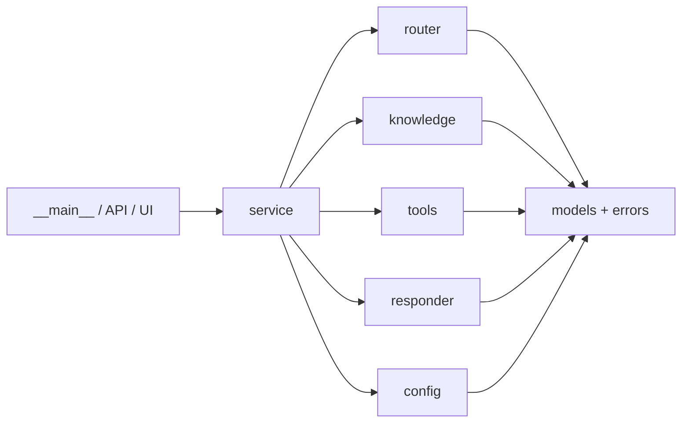

# assistant_core — Architecture

`assistant_core` is a small Python package refactored from `monolith/assistant_monolith.py`.
Behaviour is unchanged; structure is not. Every client (CLI today, FastAPI in Lab 4, UI in Lab 7)
calls one method: `AssistantService.handle(Message) -> Response`.

## 1. Modules and owners

| Module | Responsibility | Owner |
|---|---|---|
| `config.py` | Read settings from the environment / `.env`; validate | Thông |
| `errors.py` | Named exceptions (`AssistantError` and subclasses) | Hải |
| `models.py` | Public contract: `Message`, `Response`, `Intent`, `Source` (plus `Office`, `Rule`) | Hải |
| `router.py` | Choose an `Intent` with simple rules | Đức Huy |
| `knowledge.py` | Office directory (CSV) and handbook (JSON) with search | Gia Huy |
| `tools.py` | Deterministic tuition calculation | Đức Huy |
| `responder.py` | Response generation behind one `Responder` interface (template, stub LLM) | THA |
| `service.py` | `AssistantService.handle(Message) -> Response`, the only entry point | Hải |
| `logging_setup.py` | Structured JSON logs (stderr) | Thông |
| `__main__.py` | Command-line interface | Hải |

Dependency rule: leaf modules (`config`, `knowledge`, `tools`, `router`, `responder`) import only
`errors` and `models`, never each other. Only `service.py` wires them together, which avoids circular
imports and lets each member work in parallel.



## 2. Service interface

```python
AssistantService.handle(msg: Message) -> Response
```

- **Message**: `text` (1–2000 chars), `session_id` (default `"local"`).
- **Response**: `answer`, `intent`, `sources[]` (`Source(id, title)`), `degraded`
  (`True` if a fallback answered).
- **Errors**
  - Invalid input -> `ValidationError` (Pydantic, at the `Message` boundary) / `InvalidRequest`
    (e.g. credits out of range).
  - Startup -> `ConfigError` (bad or missing settings) / `DataError` (knowledge file missing or malformed).
  - Provider failures **never reach the caller**: the service catches `ProviderError`, answers with
    `TemplateResponder` and sets `degraded=True`.
- **Dependency injection**: `AssistantService(settings, offices, handbook, responder)`, so tests can
  inject a failing `StubLLMResponder(fail=True)`.
- **Logging**: intent, latency, session and degraded flag only; never the API key or the full user message.

### Responder interface

```python
class Responder(Protocol):
    def explain(self, question: str, rule: Rule) -> str: ...
```

| Implementation | Behaviour |
|---|---|
| `TemplateResponder` | `"<title>: <text>"`, no AI. Also the service's fallback. |
| `StubLLMResponder(fail=False)` | `"Based on '<title>': <text>"`; with `fail=True` raises `ProviderError`. Deterministic, no key, no sleep. |

A real provider class is added in Week 4 without changing `service.py`.

## 3. Design decisions

1. **Fees are computed in `tools.py`, never by an LLM.** Tuition is exact arithmetic: pure functions
   give the same output for the same input, are trivially unit-tested, and cannot hallucinate. A
   characterisation test (`18` credits + `2` retake = `9_450_000`) locks in the monolith's result.
2. **The LLM sits behind `Responder`; the stub needs no key.** Adapter pattern: the service depends
   on a Protocol, not a vendor. Tests and CI run offline and deterministically, failures are simulated
   with `fail=True`, and providers can be swapped without editing the service.
3. **Configuration comes from the environment; `.env.example` documents every variable.**
   (Twelve-Factor III.) Rates, limits and keys are not in code, so changing a fee means editing one
   variable. `llm_api_key` uses `repr=False` and `.env` is git-ignored, so secrets never reach Git or logs.
