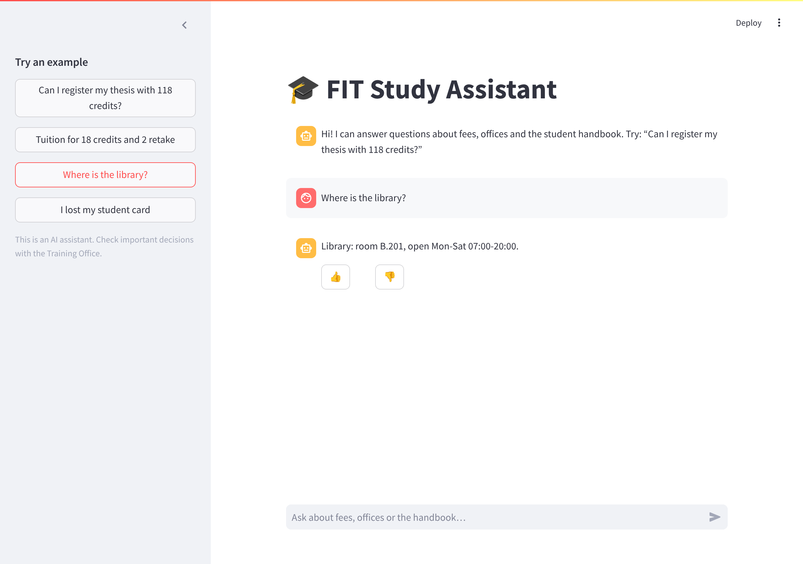
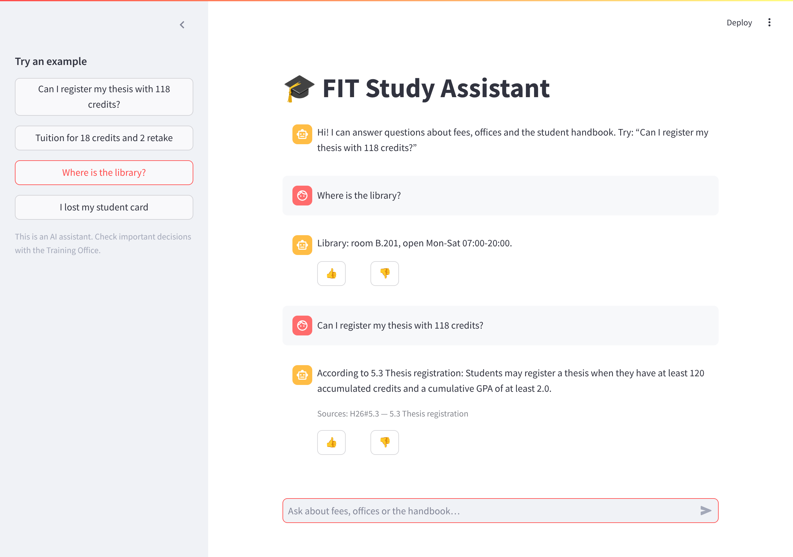
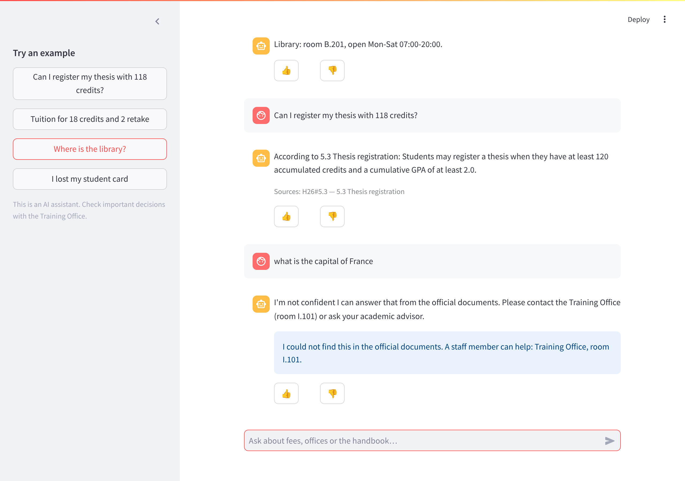
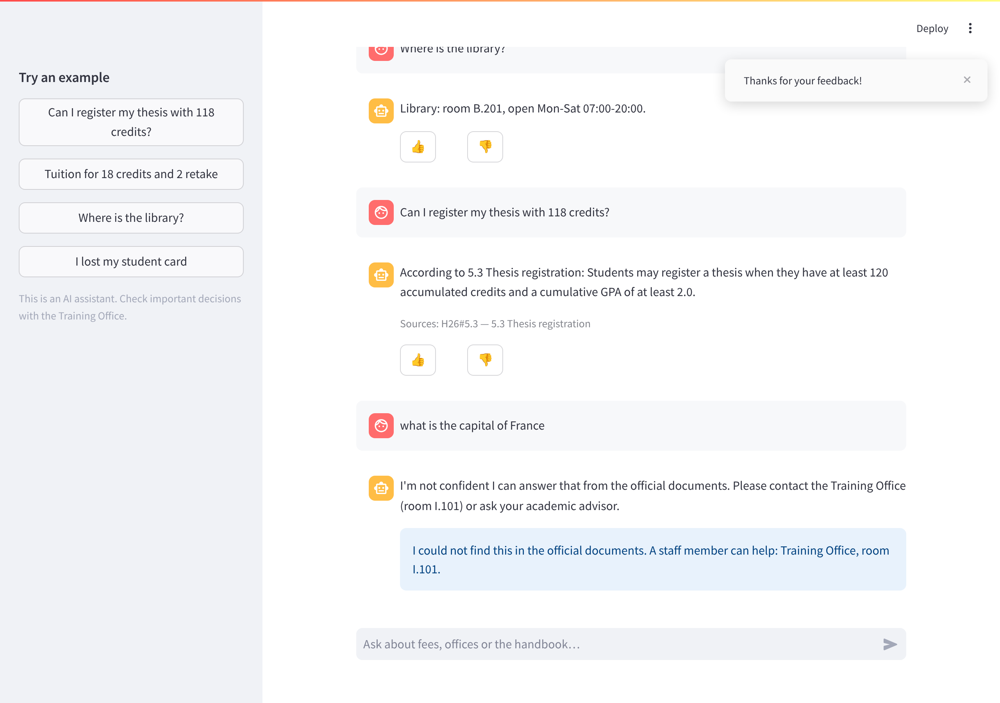
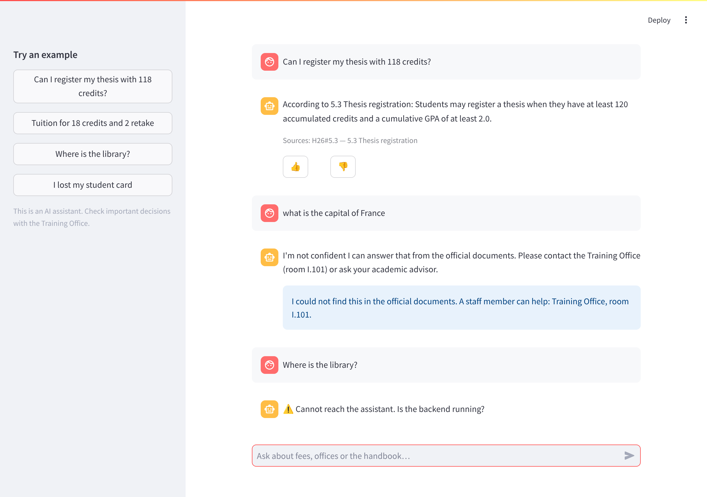
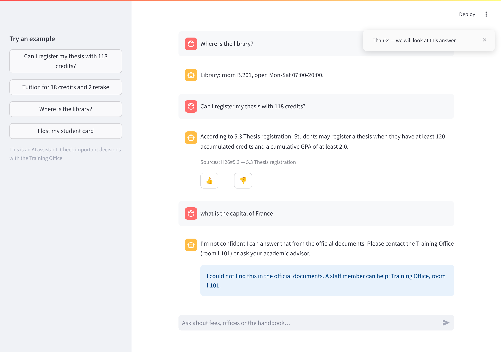

# Lab 7 D.4 — Thử đủ 6 trạng thái (Đức Huy, npdwuy)

Chạy 2 server từ thư mục gốc repo: `uvicorn assistant_api.main:create_app --factory` (port 8000, `LLM_PROVIDER=stub`)
và `streamlit run ui/app.py` (port 8501), mở trang trong Chromium (cửa sổ 1280×900). Code: branch `lab7/duchuy-core`
(L1, L2, F1 đã làm; `pytest -q tests/test_ui.py` 7 passed; nút 👍/👎 xử lý bằng `on_click` callback, xem ghi chú).

| # | Thử | Thấy gì | Đúng chưa | Ảnh |
|---|---|---|---|---|
| 1 | Bấm câu ví dụ "Where is the library?" ở sidebar | Câu hỏi hiện bên user, trả lời "Library: room B.201, open Mon-Sat 07:00-20:00." kèm 👍 👎 | Đúng |  |
| 2 | "Can I register my thesis with 118 credits?" | Trả lời "...at least 120 accumulated credits and a cumulative GPA of at least 2.0." và dòng `Sources: H26#5.3 — 5.3 Thesis registration` | Đúng |  |
| 3 | "what is the capital of France" | Trả lời "I'm not confident…" và ô note xanh "I could not find this in the official documents. A staff member can help: Training Office, room I.101." | Đúng |  |
| 4 | Enter khi ô trống | Không có tin nhắn mới (số tin nhắn 7 → 7). Ảnh giống hệt dòng 3 vì trang không thay đổi; chỉ có khoảng trắng thì hiện cảnh báo "Please type a question." | Đúng |  |
| 5 | Bấm 👍 ở câu trả lời cuối | Toast "Thanks for your feedback!", nút 👍 👎 của câu đó biến mất ngay (đếm nút 👍: 3 → 2) | Đúng (sau khi sửa, xem ghi chú) |  |
| 6 | Tắt API (Ctrl+C terminal 1) rồi hỏi "Where is the library?" | Câu trả lời "⚠️ Cannot reach the assistant. Is the backend running?", trang không crash | Đúng |  |

Thêm F1: bấm 👎 ở câu trả lời đầu tiên → toast "Thanks — we will look at this answer.", feedback `-1` được gửi (backend ghi 1 dòng rating -1 vào bảng `feedback`).
Nút của câu đó biến mất ngay (👎: 2 → 1). Bấm 2 lần thì API nhận đúng 2 lần `POST /v1/feedback` 201, không gửi trùng.

**Ghi chú dòng 5.** Lần thử đầu với code F1 theo đúng TODO của starter (`if c1.button(...): ...`), toast hiện nhưng nút
**chưa biến mất ngay**: lần chạy xử lý cú bấm đã vẽ nút xong rồi mới thêm `rid` vào `st.session_state.rated`, nên nút
chỉ ẩn ở lần rerun sau (đếm nút 👍: 3 → 3 ngay sau khi bấm). Đã sửa trong `ui/app.py`: chuyển phần xử lý của cả 👍 và 👎
sang hàm `rate()` gọi qua `on_click=`. Callback chạy **trước** khi Streamlit vẽ lại trang, nên lúc vẽ `rid` đã nằm trong
`rated` và nút biến mất ngay. F1 vẫn đúng yêu cầu: `key=f"down{i}"`, gửi `send_feedback(rid, -1)`, thêm vào `rated`, toast.
Ảnh dòng 5 và F1 là ảnh chụp sau khi sửa.
