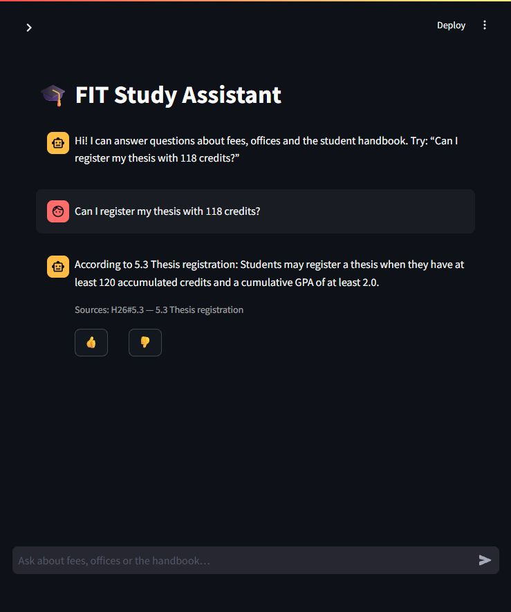
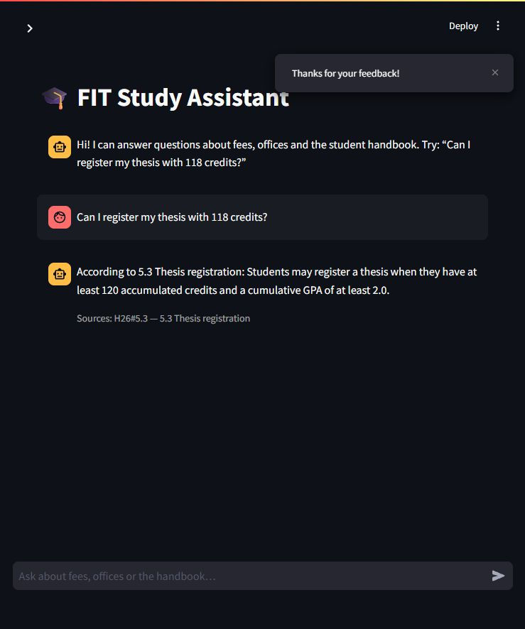
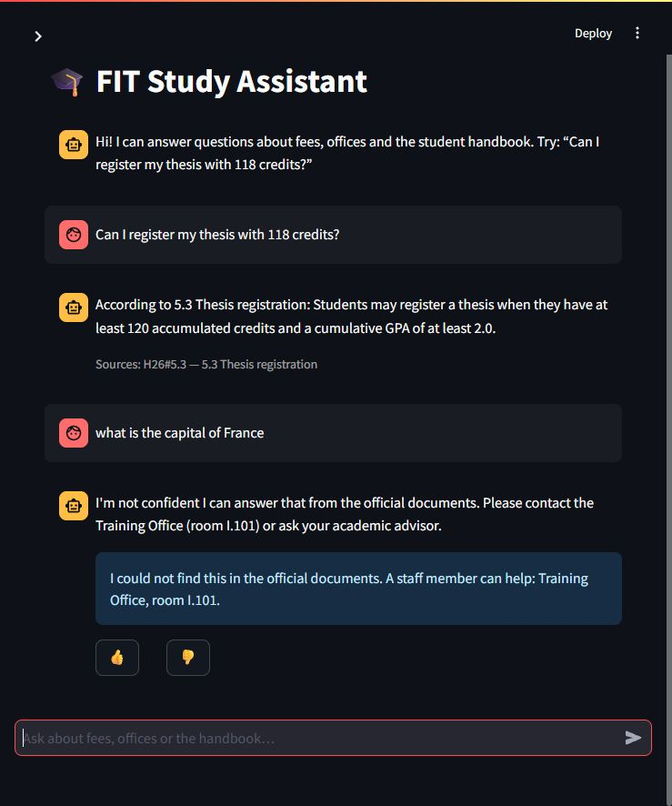
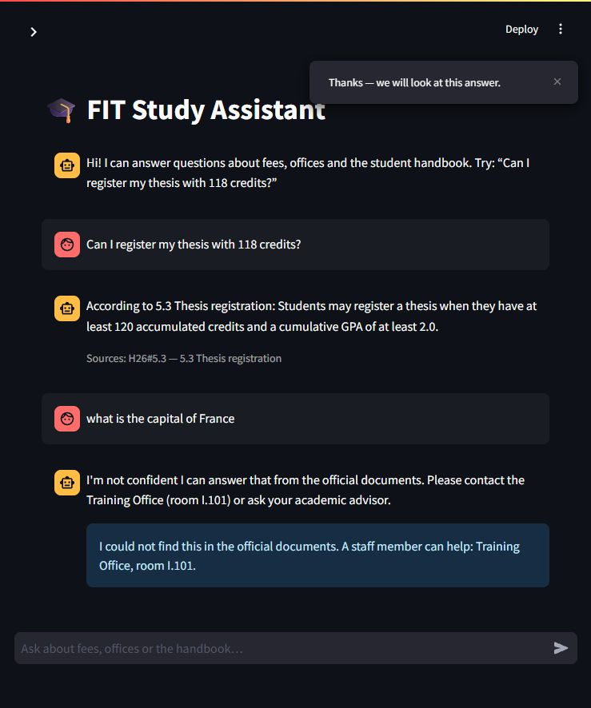
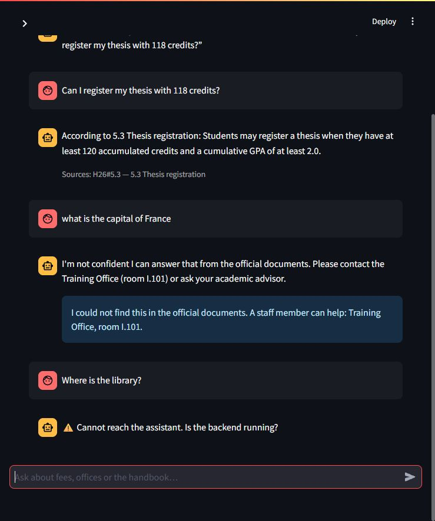

# Lab 7 — Six UI states (Gia Huy / wiih0521)

Developer verification on 2026-11-27, not a participant usability test.
Started both servers from the repository root with the offline stub:
API `127.0.0.1:8768`, UI `127.0.0.1:8571` (`ASSISTANT_API_URL` set accordingly).
Browser screenshots below are actual captures of the local app.

| Try | Observed | Result |
|---|---|---|
| Click thesis example in sidebar | Question appears, followed by the answer citing the 120-credit/GPA requirement | Pass |
| Ask “Can I register my thesis with 118 credits?” | `Sources: H26#5.3 — 5.3 Thesis registration` beneath answer | Pass |
| Ask “what is the capital of France” | Abstention and Training Office, room I.101 guidance | Pass |
| Press Enter with empty chat input | No new message and no question submitted | Pass |
| Click thumbs-up on thesis answer | Thanks toast, both rating controls disappear; API feedback returns 201 | Pass |
| Stop API, then ask “Where is the library?” | “Cannot reach the assistant. Is the backend running?”; history remains, no crash | Pass |

F1 extra: clicked thumbs-down on the France answer: API returned 201, both controls
disappeared and “Thanks — we will look at this answer.” appeared.
AppTest also verifies unsuccessful feedback remains retryable instead of pretending to save it.

