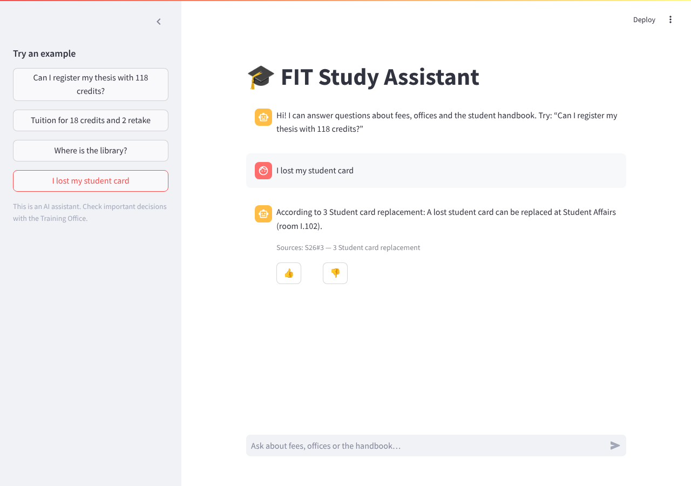
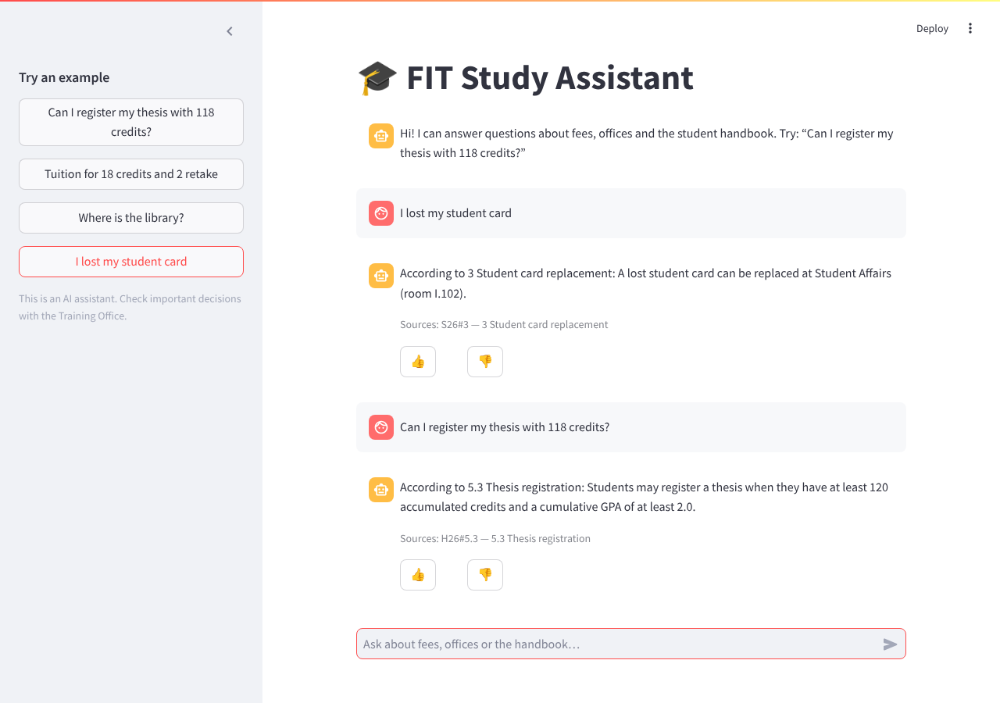
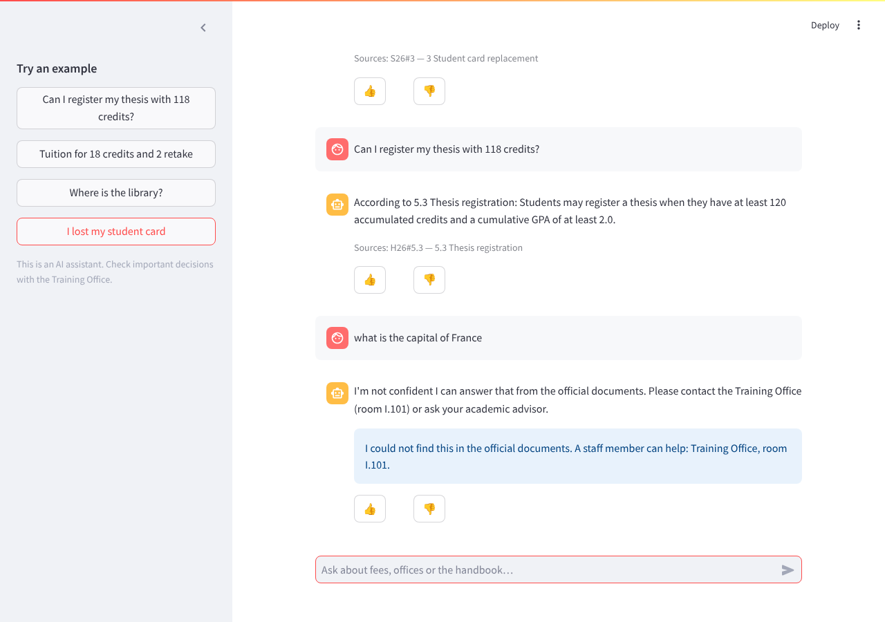
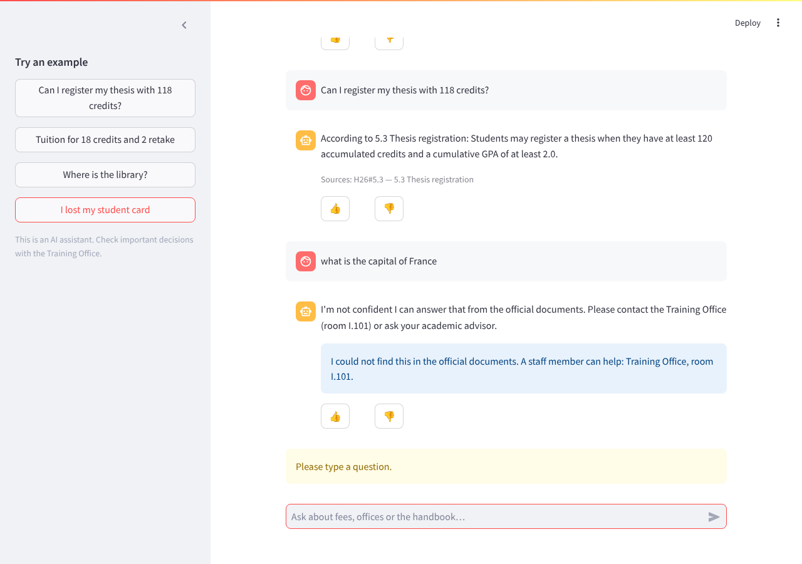
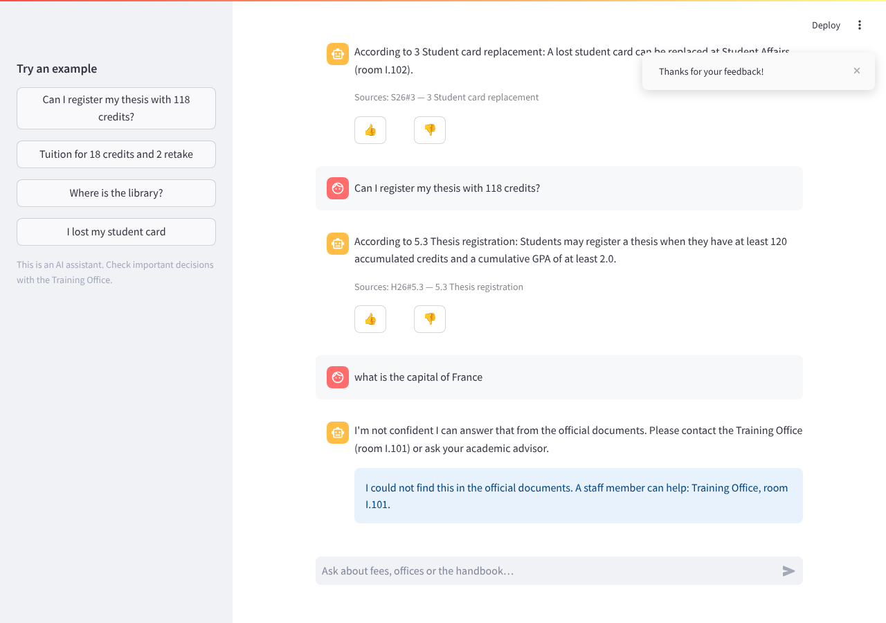
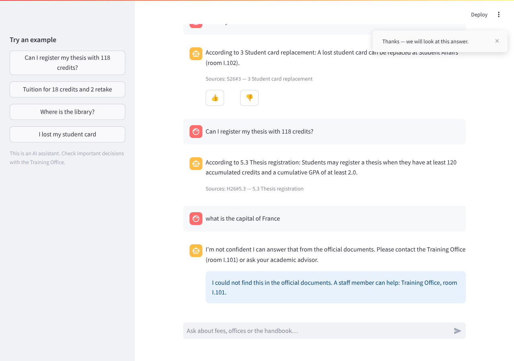
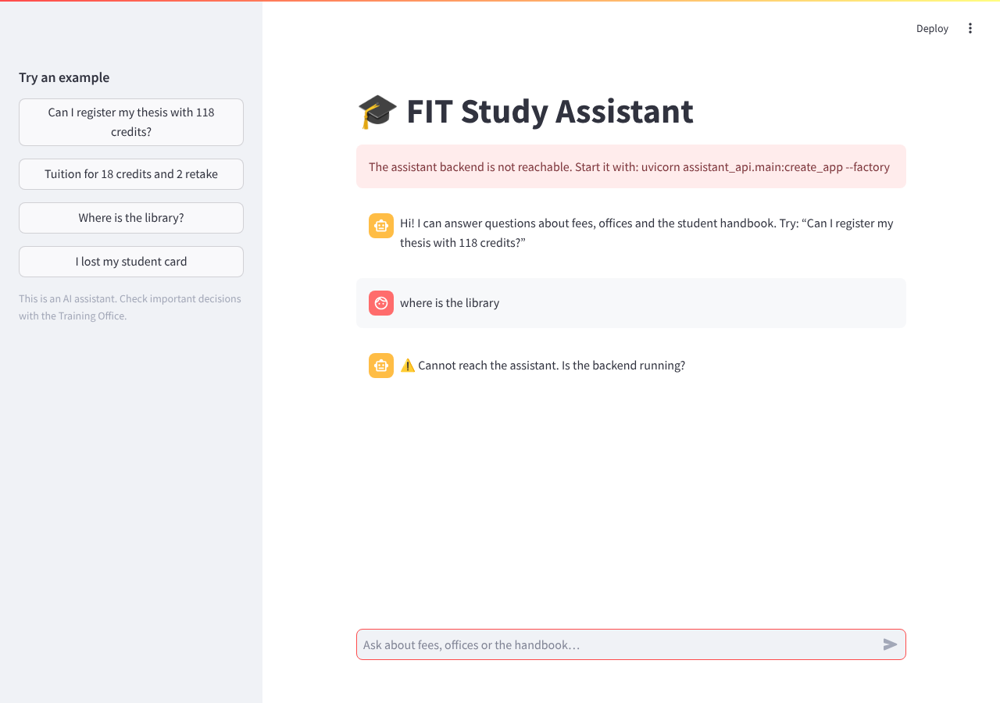
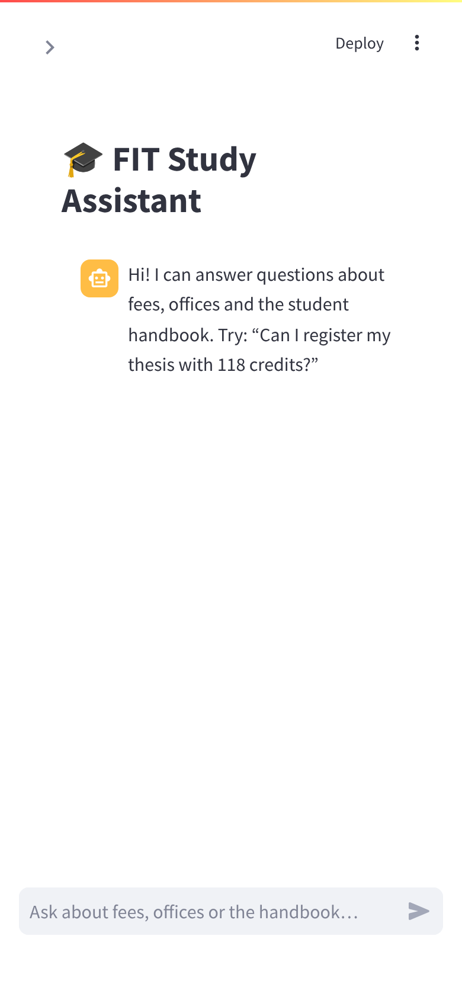

# Lab 7 D.4 — every state (Hải)

Both servers ran from the repo root: `uvicorn assistant_api.main:create_app --factory` (port 8000) and
`streamlit run ui/app.py` (port 8501), `LLM_PROVIDER=stub`. Pages were driven in headless Chromium (Playwright, 1280×900).

| # | Try | Expected on screen | What I saw | OK? |
|---|---|---|---|---|
| 1 | click "I lost my student card" in the sidebar | question and answer appear | answer "A lost student card can be replaced at Student Affairs (room I.102)" + `Sources: S26#3 — 3 Student card replacement` | ✅ |
| 2 | "Can I register my thesis with 118 credits?" | answer + `Sources: H26#5.3 — …` | "…at least 120 accumulated credits and a cumulative GPA of at least 2.0" + `Sources: H26#5.3 — 5.3 Thesis registration` | ✅ |
| 3 | "what is the capital of France" | escalation note (Training Office, room I.101) | "I'm not confident I can answer that…" + blue box "I could not find this in the official documents. A staff member can help: Training Office, room I.101." | ✅ |
| 4 | press Enter on an empty box; then only spaces | nothing is sent | empty box: no message added (7 messages before and after). Only spaces: yellow "Please type a question.", still 7 messages | ✅ |
| 5 | click 👍, then 👎 on another answer | toast "Thanks", buttons disappear | 👍: toast "Thanks for your feedback!", visible 👍/👎 buttons 6 → 4, API log `POST /v1/feedback 201`. 👎: toast "Thanks — we will look at this answer.", buttons 4 → 2, `201` | ✅ |
| 6 | stop the API (Ctrl+C), ask again | "Cannot reach the assistant…", no crash | red box "The assistant backend is not reachable. Start it with: uvicorn …" and "⚠️ Cannot reach the assistant. Is the backend running?"; 0 Streamlit exceptions | ✅ |

## Screenshots

| | |
|---|---|
| 1 sidebar example |  |
| 2 thesis 118 |  |
| 3 escalation |  |
| 4 empty Enter / spaces (warning, no new message) |  |
| 5 👍 → toast, buttons gone on that answer |  |
| 5 👎 → toast, buttons gone on that answer |  |
| 6 API stopped |  |
| phone width (390 px) |  |

## Note on F1

In the starter, a click is handled in the same run that drew the buttons, so they would stay on screen until the next
interaction. 👍 and 👎 are therefore drawn inside one `st.empty()` slot that is cleared as soon as the answer is rated.
Both buttons share one code path (`send_feedback(rid, 1 or -1)`, add `rid` to `rated`, toast). 👎 uses `key=f"down{i}"`.
If this conflicts with the version on `main`, keep `main`'s.
