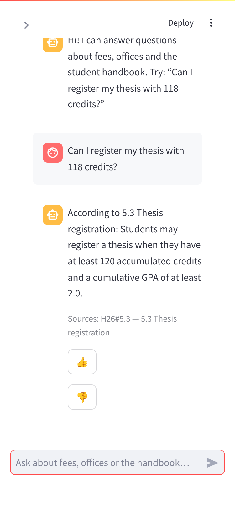

# Lab 7 — Usability checklist (Đức Huy, npdwuy)

Kiểm tra trên branch `lab7/duchuy-core`, 2 server chạy local, Chromium 1280×900 và 375×812 (độ rộng điện thoại).

- [x] The first screen says what the assistant can do, with example questions — câu chào "Hi! I can answer questions about fees, offices and the student handbook…" + 4 câu ví dụ ở sidebar
- [x] Empty or too-long input shows a friendly message (not a crash) — ô trống: không gửi gì; 2001 ký tự: "Your question is too long (max 2000 characters)."
- [x] While waiting, the user sees "Thinking…" — `st.spinner("Thinking…")` trong `ui/app.py`
- [x] Every answer from documents shows its sources — `Sources: H26#5.3 — 5.3 Thesis registration` (D.4 dòng 2)
- [x] "I don't know" answers tell the user who can help (escalation) — Training Office, room I.101 (D.4 dòng 3)
- [x] If the backend is down, the page says so clearly — đầu trang có banner đỏ "The assistant backend is not reachable. Start it with: uvicorn …", câu trả lời là "⚠️ Cannot reach the assistant. Is the backend running?" (D.4 dòng 6; ảnh dòng 6 cuộn xuống nên không thấy banner)
- [x] Each answer has 👍 / 👎, and clicking gives a "thanks" message — có cả 2 nút, toast cảm ơn, nút biến mất ngay sau khi bấm (sửa bằng `on_click`, ghi chú trong `states-duchuy.md`)
- [x] The page says it is an AI assistant — sidebar: "This is an AI assistant. Check important decisions with the Training Office."
- [x] Text is readable (size, contrast); buttons have clear labels — chữ mặc định của Streamlit, nút ví dụ có chữ đầy đủ
- [x] Works on a phone-width window — 375 px không bị cuộn ngang (`scrollWidth` = 375), ảnh bên dưới; ở điện thoại sidebar bị thu gọn nên câu ví dụ nằm sau nút `>`, câu chào vẫn có 1 ví dụ

## Hallway test (Part E.3)

TODO (Đức Huy tự làm): nhờ 1 bạn **nhóm khác** dùng trang 2 phút, không giải thích, ghi 1–2 câu về 1 điều làm họ bất ngờ.
