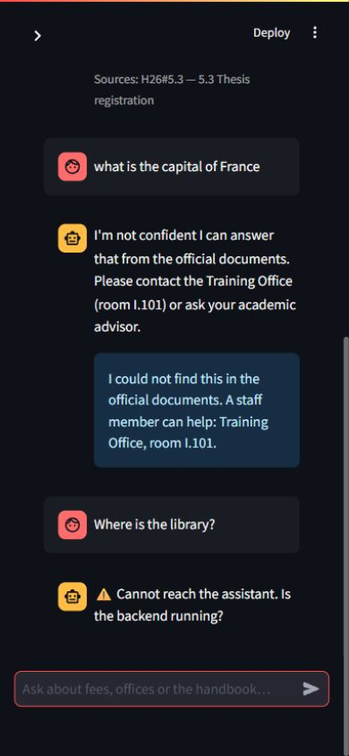
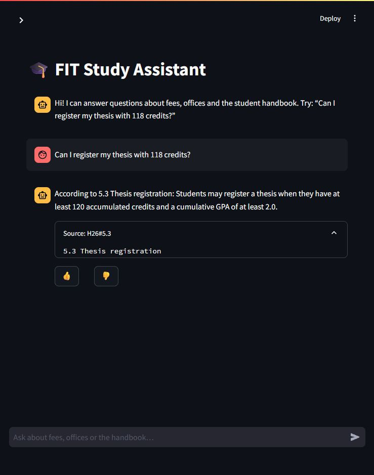
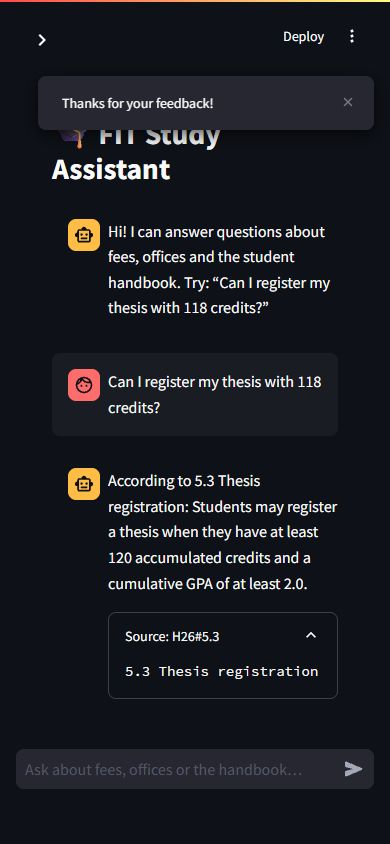

# Lab 7 — Usability checklist (Gia Huy / wiih0521)

Developer checks on 2026-11-27; participant testing remains pending.

- [x] First screen explains scope and provides examples.
- [x] Empty Enter does not submit; long input is validated with a friendly warning (AppTest).
- [x] “Thinking…” appears while the request is running (observed during API-offline check).
- [x] Document answer displays source ID/title.
- [x] Abstention names the Training Office, room I.101.
- [x] Stopped backend produces a readable error without losing history.
- [x] Answer with request ID has thumbs-up/down; saved ratings show thanks and hide both buttons.
- [x] Sidebar identifies the product as an AI assistant.
- [x] Dark-theme text is readable; feedback controls have explanatory help text.
- [x] Phone-width viewport 390 × 844: text wraps and chat input remains reachable; DOM scroll width equals viewport width (390), no horizontal page overflow.

## Hallway test — pending real participant

- [ ] A student from another group used the app unassisted for two minutes.
- First name or anonymous participant label: **pending**.
- Date: **pending**.
- One thing that surprised them, in their own words: **pending**.

No participant observations are inferred from automated tests or the developer browser check.

## Bonus — source expanders

Each newly received source has its own `Source: <id>` expander; expanding it reveals
the title as plain text. Existing session messages that only contain the formatted
source caption still display correctly. This UI change does not import backend code
or alter answers, grounding or HTTP requests.

Verified on desktop and at 390 × 844: source ID/title and answer wrap without horizontal
page overflow (`scrollWidth == innerWidth == 390`); a saved rating during the phone
check produced the thanks toast and removed both controls. This is a developer check,
not the participant-driven H1 observation/fix.

Before bonus: [caption screenshot](img/giahuy-core-sources.jpg).

Merge the bonus/homework branch only after the L1/L2/F1 core branch; when shared-file
conflicts arise, preserve the team's merged core behavior and reapply only the source view.
