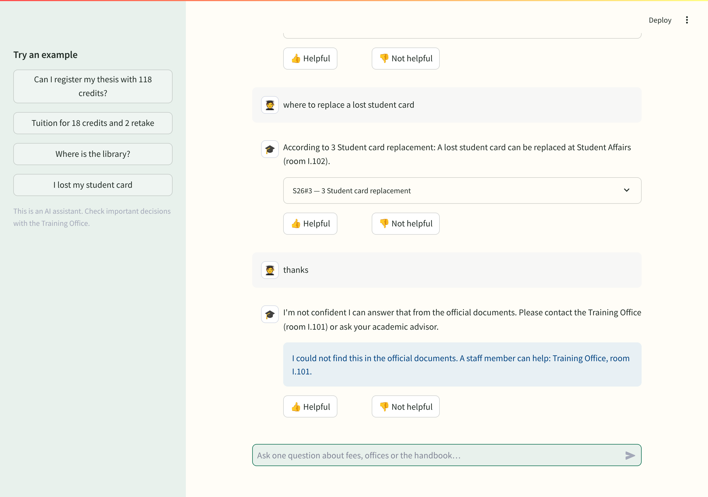
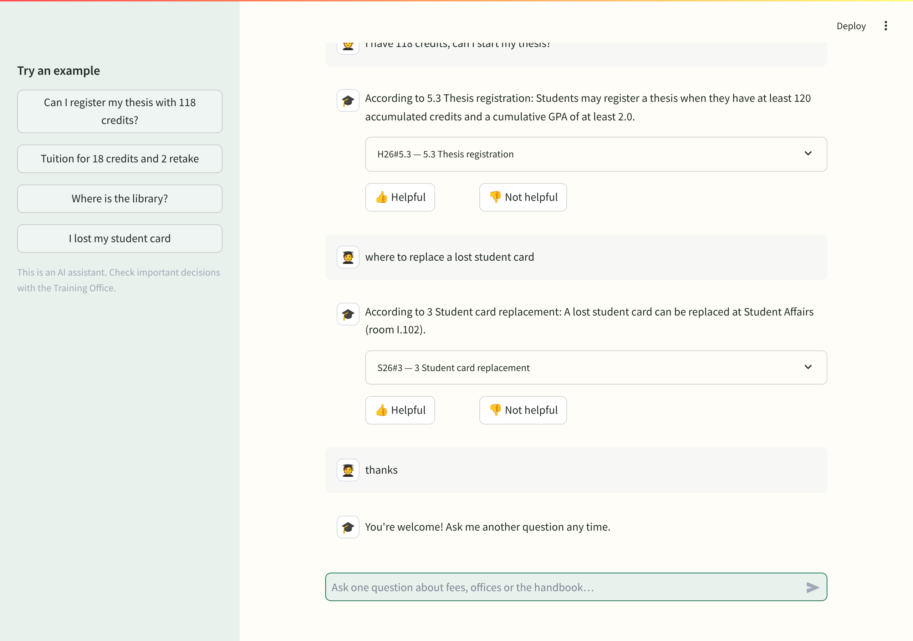

# Lab 7 homework — 10-minute usability test (Đức Huy, npdwuy)

> **Lưu ý: đây là phiên test MÔ PHỎNG bằng AI (Claude Code), KHÔNG phải test với người thật.**
> Đức Huy đã test với một người ngoài nhóm nhưng không ghi lại chi tiết và không nhớ được, nên không thể điền
> quan sát thật vào phiếu. Thay vào đó, Claude Code đóng vai một sinh viên lần đầu dùng trang, làm đúng task của
> đề trên UI thật (bản `main` sau #80, `LLM_PROVIDER=stub`), và ghi lại các chỗ gây khó **thật sự xảy ra** trên
> giao diện. Các quan sát dưới đây là của phiên mô phỏng đó, không phải lời của một người test.
> Nếu còn kịp trước hạn, nên thay bằng quan sát từ một người thật.

Tester (not in your team, first name only): *không có, mô phỏng bằng AI*  Date: 2026-11-28
Task you gave them: "Find out if you can register your thesis with 118 credits, and where to replace a lost student card."

Rule: do not help or explain. Watch and write down what happens.

| # | What the tester did or said | What they expected | Why the system/UI caused it | Fix idea |
|---|---|---|---|---|
| 1 | Typed `I have 118 credits, can I start my thesis?`. Got "According to 5.3 Thesis registration: Students may register a thesis when they have at least 120 accumulated credits and a cumulative GPA of at least 2.0." and had to compare 118 with 120 by themselves. The same answer comes back for `thesis 118 credits` and `can i register thesis` | A direct "No, not yet: you need 120 credits, you have 118 (2 more)" | With the default offline provider (`LLM_PROVIDER=stub`) the answer is the first sentence of the handbook passage; nothing compares the number in the question with the 120-credit rule | Backend: read the credit number from the question and add one line "Not yet: you need 2 more credits" under the quote |
| 2 | After learning the card is replaced at Student Affairs, went one step beyond the task and typed `student card replacement fee`. Got "A lost student card can be replaced at Student Affairs (room I.102)." with nothing about the fee, and opening the source box `S26#3 — 3 Student card replacement` showed only its title again | The fee (or the full passage to read it) | The handbook passage does say "The replacement fee is 50,000 VND…" (`data/kb/services_2026.md`), but the offline stub provider answers with only the **first sentence** of the source, and the source expander in `ui/app.py` shows only the title, not the passage | Show the passage text inside the source expander (needs the API to return it), or run with the `template` / a real provider |
| 3 | After getting both answers, typed `thanks`. Got "I'm not confident I can answer that from the official documents. Please contact the Training Office…" plus the blue escalation box "I could not find this in the official documents…" | A short "You're welcome" | The router has no intent for thanks/bye, so the message is treated as an unknown question and escalated; at the end of a task that worked it looks like an error | UI answers a message that is only thanks/bye itself, without calling the API. **This is the fix below.** |

The one change we made (commit link): observation 3. `small_talk_reply()` in `ui/logic.py` returns a friendly reply
when the whole message is only thanks/bye (English, or Vietnamese with or without accents; any case or punctuation), and `ui/app.py` shows it
without calling the API; real questions, including "thanks, and where is the library?" and "hello" (the backend
already answers greetings), still go to the API. Tests: `tests/test_ui_small_talk.py`. Commit: [`29937df`](https://github.com/NewFace819/CS252---Lab3--Monolith/commit/29937df).

Before / after screenshot (same session: thesis question, lost-card question, then `thanks`):

| Before | After |
|---|---|
|  |  |
