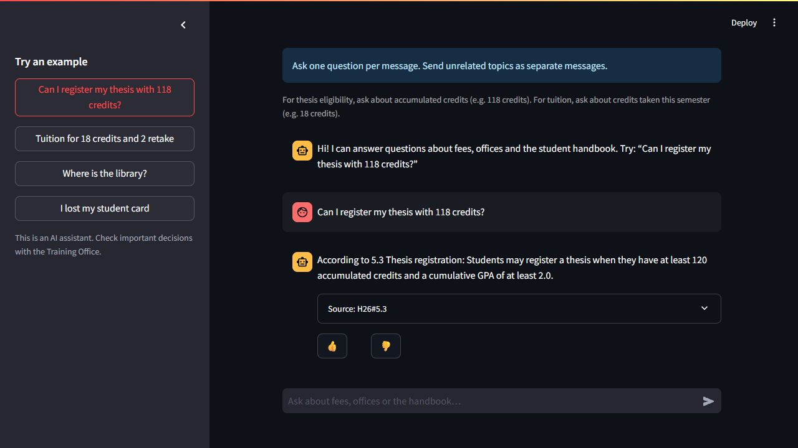

# Lab 7 — 10-minute user test (Gia Huy / wiih0521)

Status: **three participant feedback items recorded, with observation 3 fixed**.
Gia Huy confirmed the session details, outside-group eligibility and assigned-task
completion below. Participant re-testing after the fix is not claimed.
Developer/browser/AppTest checks are documented separately.

Participant: **P1 (anonymous label for this record; no real name collected)**.
Eligibility: **student at another school, outside the project group**, confirmed by Gia Huy.
Date: **2026-11-27**.
Duration: **not timed**. The initial estimate was about 6 minutes; Gia Huy later clarified
that no start/end times were recorded, so the exact duration and whether it reached the
requested 10 minutes cannot be established.
Assigned task attempted/completed: **yes**, confirmed by Gia Huy.

Task, exactly as assigned: “Find out if you can register your thesis with 118 credits,
and where to replace a lost student card.”

| # | What they did or said | What they expected | UI/system cause | Proposed fix |
|---|---|---|---|---|
| 1 | Gia Huy relayed that the tester asked whether Vietnamese was available ("không có tiếng việt à"). | Inferred: Vietnamese interaction or a visible language option; not yet directly confirmed with the tester. | Analysis: UI and examples are in English; supported language is not explicitly stated. | Clearly state that the current demo supports English questions, with English examples; full Vietnamese support is outside the required H1 fix. |
| 2 | Gia Huy reported the tester's feedback: "phạm vi trả lời cũng không rộng" (the answer coverage is limited). | Inferred: answers on a wider range of topics; exact question/topic still needs recording. | Analysis: the demo only contains sample fees, offices and selected handbook policies; the opening copy does not clearly explain these limits. | Clarify the supported topics and that the knowledge base is limited/sample data; expanding the backend knowledge base is not required for this UI fix. |
| 3 | Gia Huy relayed: "add nhiều câu không liên quan trực tiếp tới nhau thì nó chỉ trả lời 1 cái =))" (multiple unrelated questions in one message get only one answer). Supplied screenshot confirms the exact prompt/response below. | Inferred: an answer to each question in the message, rather than only one topic. | Analysis: `tuition` routes the message to the fee calculator, which rejects 118 as a semester credit load and returns without answering the card-replacement part. The UI does not explain that independent questions should be sent separately or distinguish accumulated credits from credits used for tuition calculation. | Add visible one-question-per-message guidance and distinguish thesis eligibility from semester tuition with appropriate examples; multi-intent decomposition is a separate backend enhancement, not required for this UI fix. |

## Evidence and missing details

All three observations were added on 2026-11-27 from Gia Huy's reports in chat, not from
a direct transcript. The exact prompt/response for observation 2
was not captured. Participant eligibility has now been confirmed by Gia Huy.
Proposed causes/fixes are developer
analysis; they are not additional participant quotes.

### Observation 3 — supplied screenshot

- User message: `tuition for 118 credits and where to replace a lost student card`
- Assistant answer: `Credits must be between 1 and 30.`
- The visible response does not answer where to replace the card. It also shows a
  mismatch between the assigned thesis-eligibility task (118 accumulated credits)
  and the tester's tuition wording (semester credits); this is not evidence that
  the backend's 30-credit tuition validation should be removed.
- Screenshot supplied by Gia Huy on 2026-11-27, preserved without editing:

## Selected fix — observation 3

Selected because the supplied screenshot shows a concrete misunderstanding during the
assigned task: a mixed tuition/card question receives only the tuition validation error.
The user selected this observation for the H1 fix.

Added a small, always-visible guidance block below the app title:

- “Ask one question per message. Send unrelated topics as separate messages.”
- Distinguish accumulated credits for thesis eligibility (118) from credits taken
  this semester for tuition (18), using the existing sidebar examples for each.

Code change: [00a061c — clarify single-question flow](https://github.com/NewFace819/CS252---Lab3--Monolith/commit/00a061c790e721a67f5a3adc7a3ee42aa052df8e).
This changes UI guidance only: it does not split a mixed question automatically,
remove the 30-credit tuition check or claim broader language/topic support.

### Before

Unmodified screenshot supplied by Gia Huy, copied to the required before filename:

### After

Actual developer browser capture after the fix, showing the guidance and the separately
submitted thesis question. The image was saved as PNG without altering its content.

Developer verification on 2026-11-27: sent the thesis example and then the lost-card
example as separate messages; received the 120-credit/GPA requirement with H26#5.3,
then Student Affairs, room I.102 with S26#3. UI tests: 13 passed; Ruff check/format passed.
These checks establish the UI is functioning, not that the participant's confusion
has been resolved. A participant follow-up remains to be done.

The source-expander bonus was implemented independently of participant research;
its screenshots must not be presented as a participant-driven H1 fix.
