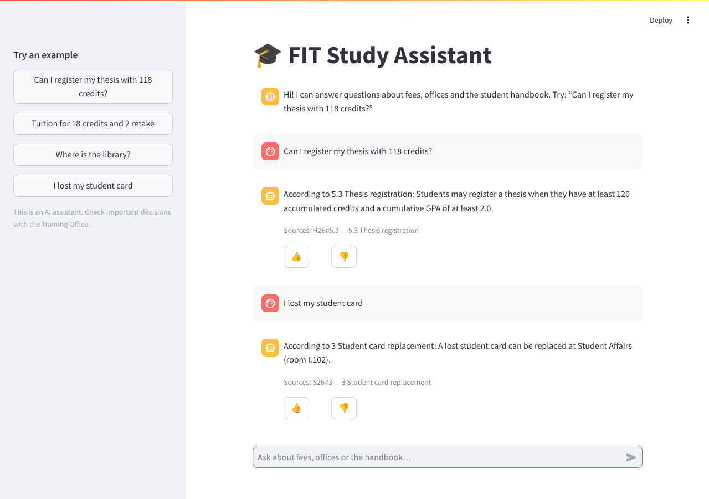
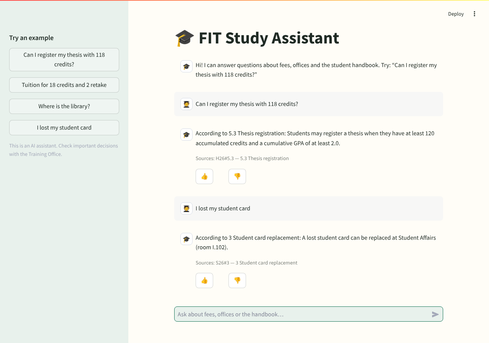

# Lab 7 homework — 10-minute usability test (Hải)

Tester (not in my team, first name only): Lâm  Date: 2026-11-27
Task I gave them: "Find out if you can register your thesis with 118 credits, and where to replace a lost student card."

Rule: do not help or explain. Watch and write down what happens.

| # | What the tester did or said | What they expected | Why the system/UI caused it | Fix idea |
|---|---|---|---|---|
| 1 | Said the app is OK ("cũng ok") and solves the main problem, but looks too generic, "like an AI app", and monotonous | A page with its own look, something that feels like a university tool | Stock Streamlit theme: grey sidebar, default red/orange chat avatars, no brand colour | Custom theme (`.streamlit/config.toml`) and graduation-cap avatars. **This is the fix below.** |
| 2 | Said the answers show no evidence "kiểu link gì hết" (no link to a source) | A clickable link or reference they could open to check the claim | The UI only shows a small grey caption `Sources: H26#5.3 — 5.3 Thesis registration`; `Source` has only `id` and `title` (no URL), so it looks like a code, not a reference | Show each source as its own expander (id, title, the quoted passage); add a `url` field to `Source` if documents have a public page |
| 3 | Said the answers feel quite generic ("khá chung chung") and asked whether more information could be given | A fuller answer with extra detail, not one sentence | The answer is a single passage from the handbook ("According to 5.3 Thesis registration: …"); it does not explain what 118 vs 120 credits means for the student or what to do next | Add a next-step line after the answer (e.g. "You are 2 credits short of 120"), or show the surrounding handbook section |

All three rows are the tester's own comments, passed on to me. The "why" and "fix idea" columns are my analysis of the code.

The one change we made: observation 1 — `.streamlit/config.toml` (green/cream theme) and `AVATARS` in `ui/app.py`
(🎓 for the assistant, 🧑‍🎓 for the user). The behaviour is unchanged.

Before / after screenshot (same two questions, 1280×900):

| Before | After |
|---|---|
|  |  |
