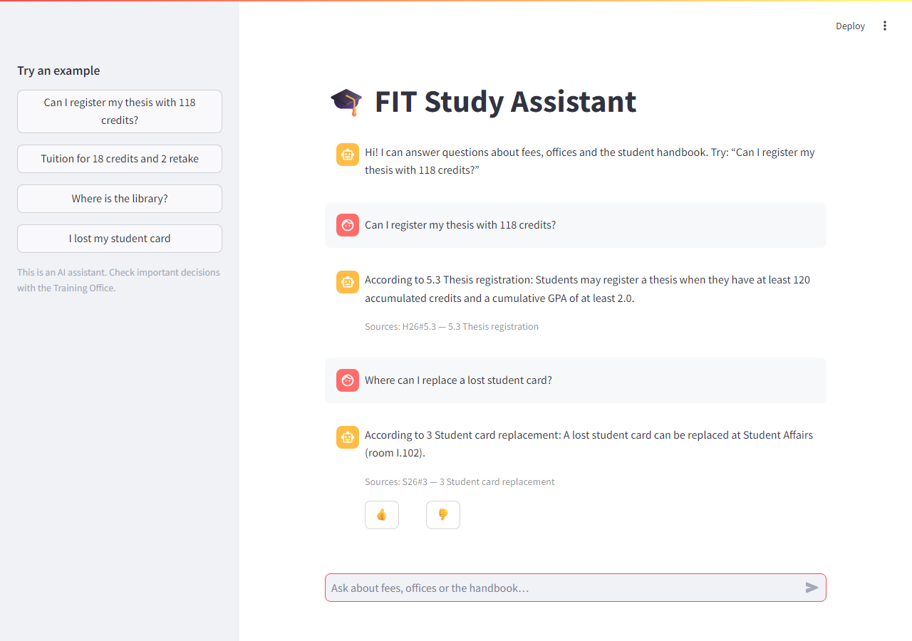
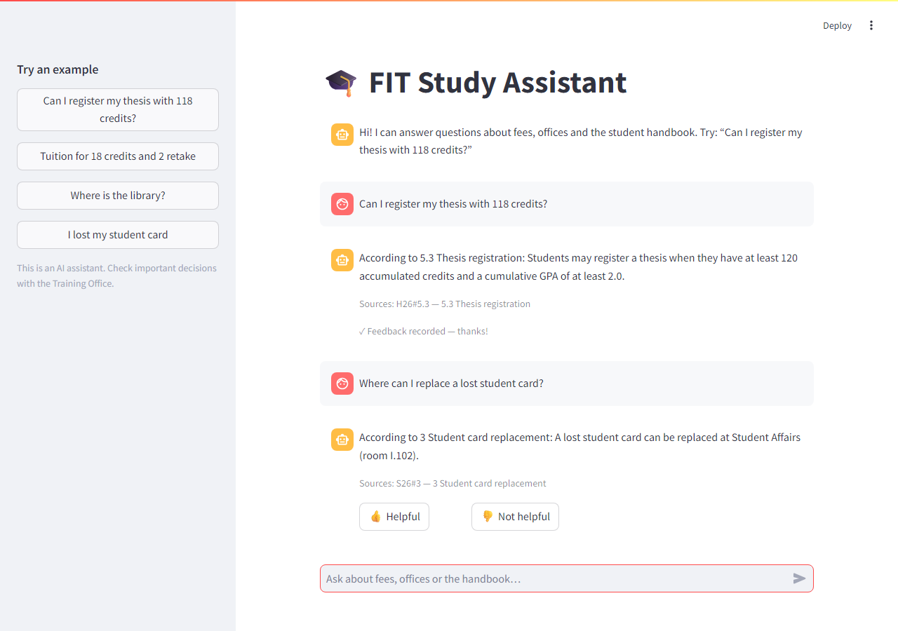

# Lab 7 H1 — 10-minute usability test (Từ Hoàng Anh)

Tester (not in your team, first name only): Khánh  Date: 2026-11-27
Task you gave them: "Find out if you can register your thesis with 118 credits, and where to replace a lost student card."

Rule: do not help or explain. Watch and write down what happens.

| # | What the tester did or said | What they expected | Why the system/UI caused it | Fix idea |
|---|---|---|---|---|
| 1 | Typed both parts of the task in a single message: `"Can I register my thesis with 118 credits, and where to replace a lost student card?"` | Answers for both thesis eligibility and student card replacement in one reply | Neither the welcome message nor the chat placeholder says to ask one topic at a time, and retrieval returns only the single top matching chunk (`S26#3`), silently dropping the thesis part | Remind the user to ask one question at a time in the input placeholder/welcome text, or split multi-question prompts in the backend |
| 2 | Clicked 👍 on the thesis answer, then looked back at the message after the toast disappeared and asked whether their vote was actually saved; also hesitated over the bare 👍 / 👎 icons | Clear text labels on the feedback buttons and a visible confirmation next to the rated answer | The buttons only showed bare emojis (`👍` / `👎`), and `slot.empty()` removed them completely after clicking, leaving no persistent confirmation once the brief toast faded | Label the buttons `👍 Helpful` and `👎 Not helpful`, and replace them with a persistent `✓ Feedback recorded — thanks!` caption after voting |
| 3 | Looked for a "New chat" / "Clear chat" button before starting the second question (and on a narrow window missed the sidebar examples completely) | A visible way to reset the conversation without reloading the browser tab | `ui/app.py` keeps all turns in `st.session_state.messages` with no reset control, and the example buttons + AI disclaimer live only in the collapsible sidebar | Add a `New chat` button in the sidebar and keep a compact AI disclaimer visible in the main pane |

The one change we made (commit link): [`b7981f7`](https://github.com/NewFace819/CS252---Lab3--Monolith/commit/b7981f7a5ce79b4e1d005603a2c32252a8bb99c5) — fixed observation #2 in `ui/app.py` (added `👍 Helpful` / `👎 Not helpful` labels and a persistent `✓ Feedback recorded — thanks!` caption after voting).

Before / after screenshot:

| Before (`hoanganh-before.png`) | After (`hoanganh-after.png`) |
|---|---|
|  |  |
