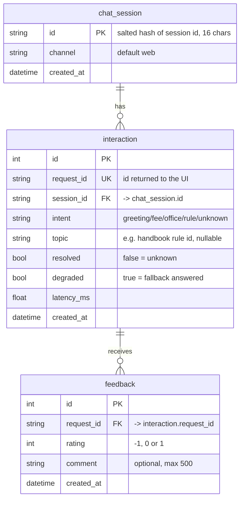

# Lab 5 — Data model worksheet

Schema of record: `src/assistant_api/db.py` and `sql/migrations/001_init.sql`.

## 1. Critique the bad schema (sql/bad_schema.sql)

| # | Problem | Why it hurts | Fix in our design |
|---|---|---|---|
| 1 | `id INTEGER` has no `PRIMARY KEY` (and no `NOT NULL`/`UNIQUE` anywhere) | Two rows can share an id or have none, so no row can be pointed to reliably | `id` is a primary key in every table; `request_id` is `UNIQUE NOT NULL` |
| 2 | `student_name`, `student_phone` stored with every message | Personal data that no feature needs: a leak or misuse risk, and restricted by Vietnam's Personal Data Protection Law | These columns do not exist. We keep only a salted hash of the session id |
| 3 | `message` (the full raw text) kept forever | Free text may contain names, phone numbers, student ids; the longer it is kept, the larger the risk | The raw question is never stored. We keep only `intent`, `topic`, `resolved` |
| 4 | `intent` is free text (`'fee'`, `'Fee'`, `'FEE'`, `'tuition'`) | `GROUP BY intent` splits one intent into several groups, so counts are wrong | `intent` comes from the `Intent` enum (`greeting/fee/office/rule/unknown`), is `NOT NULL` and indexed |
| 5 | `time` stored as text like `'5/10/2026 9:03 PM'` | Ambiguous (5 Oct or 10 May?), cannot be sorted or range-filtered correctly | `created_at TIMESTAMP` (UTC), indexed |
| 6 | `feedback` is a comma-separated list `'1,-1,1'` in one column | Breaks first normal form: cannot `AVG`/`COUNT`, cannot join, nothing blocks a rating of 7 | Separate `feedback` table, one row per rating, `CHECK (rating IN (-1, 0, 1))`, foreign key to `interaction` |
| 7 | `latency` stored as text `'120ms'` | Cannot `AVG`/`MAX`; the unit is mixed into the value | `latency_ms FLOAT NOT NULL` |
| 8 | Everything in one table (session, message, answer, feedback) | The same data is repeated per row; one session or answer cannot have several feedbacks cleanly | Three tables linked by foreign keys (see section 4) |

## 2. Store or not? (privacy-aware storage)

Retention values are our proposal; the code does not enforce deletion yet.

| Data | Store? | Form | Retention | Reason |
|---|---|---|---|---|
| raw user message | **No** | none | n/a | May contain personal details; no feature needs it. Intent and topic are enough to improve the bot |
| session id | **Yes** | hashed: `sha256(salt + raw)[:16]`, salt from `SESSION_SALT` in `.env` | as long as its interactions (proposal: 90 days) | Lets us count sessions and group interactions without knowing who the user is. One-way, so the id cannot be recovered |
| intent, latency, topic | **Yes** | raw values (metadata only) | proposal: 12 months, or aggregate later | Tells us what to improve: which intents fail, which are slow, which rules are asked about |
| feedback rating | **Yes** | raw (`-1`, `0`, `1`) | same as interaction | The whole point of feedback; also validated by a `CHECK` |
| feedback comment | **Yes, optional** | raw, max 500 chars | proposal: 90 days | Explains a rating, but is free text a user can type anything into, so it is optional, length-limited and readable only with the admin key |
| student name / phone | **No** | none | n/a | No feature needs it; storing it only adds risk |

## 3. Product questions → fields

| Product question | Fields needed | Table(s) | Query sketch |
|---|---|---|---|
| Most failed intent? | `intent`, `resolved` | `interaction` | `SELECT intent, COUNT(*) FROM interaction WHERE resolved = 0 GROUP BY intent ORDER BY 2 DESC;` |
| Average response time by intent? | `intent`, `latency_ms` | `interaction` | `SELECT intent, ROUND(AVG(latency_ms), 1) FROM interaction GROUP BY intent;` (served by `GET /v1/stats/intents`) |
| Top unresolved topics? | `topic`, `resolved` | `interaction` | `SELECT topic, COUNT(*) FROM interaction WHERE resolved = 0 AND topic IS NOT NULL GROUP BY topic ORDER BY 2 DESC;` |
| Which topics get the most thumbs-down? | `rating`, `request_id`, `topic` | `feedback` JOIN `interaction` | `SELECT i.topic, COUNT(*) FROM feedback f JOIN interaction i ON i.request_id = f.request_id WHERE f.rating = -1 GROUP BY i.topic ORDER BY 2 DESC;` |
| How many sessions per day? | `session_id`, `created_at` | `chat_session` | `SELECT DATE(created_at), COUNT(*) FROM chat_session GROUP BY 1;` |

## 4. ER diagram

- One session has many interactions (`interaction.session_id` → `chat_session.id`).
- One interaction can receive many feedbacks (`feedback.request_id` → `interaction.request_id`). The API returns 404 if the `request_id` does not exist, so feedback always refers to a real answer.
